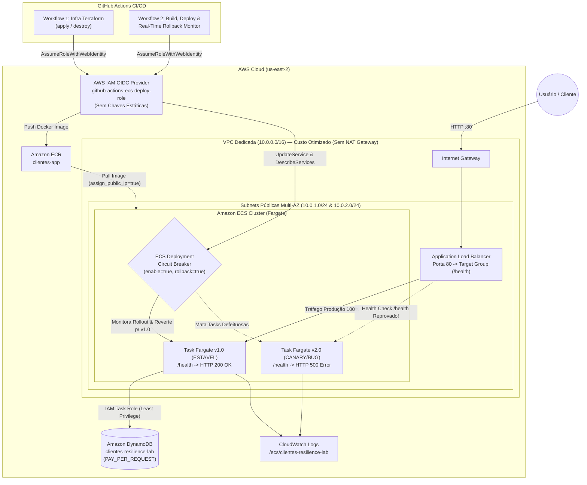
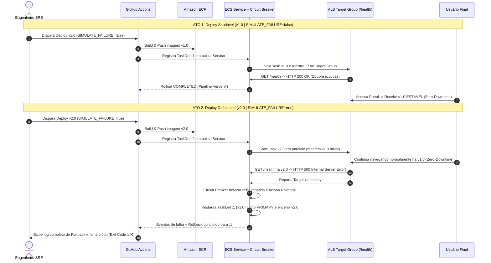

# 🛡️ AWS ECS Zero-Downtime & Auto-Rollback Lab


Projeto prático de engenharia **DevOps / SRE** que demonstra na prática **Zero-Downtime Deployment** e **Rollback Automático em Tempo Real** utilizando **Amazon ECS (Fargate)**, **Application Load Balancer (ALB)**, **Amazon ECR**, **Amazon DynamoDB**, **Terraform** e **GitHub Actions com autenticação OIDC (sem chaves estáticas)**.

---

## 🎯 Objetivo de Engenharia

Em ambientes críticos de produção, um deploy contendo um bug de inicialização ou regressão de saúde não pode derrubar o serviço em produção nem depender de intervenção humana tardia. Este laboratório implementa uma arquitetura resiliente ponta a ponta onde:

1. **Zero-Downtime Deployment (`100% / 200%`)**: Durante cada release, o ECS provisiona a nova versão em paralelo (`deployment_maximum_percent = 200`) mantendo `100%` da capacidade saudável atual ativa até que os novos containers passem nos Health Checks do ALB e do container.
2. **Detecção Rápida de Anomalias**: O Target Group do ALB valida continuamente a rota `/health` a cada `10 segundos` (`unhealthy_threshold = 2`).
3. **Auto-Rollback Nativo (`ECS Deployment Circuit Breaker`)**: Ao detectar falhas consecutivas na nova revisão (`v2.0`), o Circuit Breaker interrompe imediatamente o rollout, reverte a Task Definition `PRIMARY` de volta para a última revisão estável conhecida (`v1.0`) e encerra as tasks defeituosas sem derrubar nenhuma requisição de clientes.
4. **Observabilidade Completa no CI/CD**: O pipeline do GitHub Actions acompanha os eventos reais do cluster ECS em tempo real (`aws ecs describe-services --query 'services[0].events[0:5]'`), exibindo no log da esteira a reprovação do health check e a reversão automática antes de encerrar o job com `exit code 1`.

---

## 🏛️ Arquitetura da Solução

### 1. Topologia de Infraestrutura e Segurança



### 2. Fluxo do Rollback Automático (Sequência em 2 Atos)



---

## 📂 Estrutura de Diretórios

```text
aws-ecs-auto-rollback-lab/
├── app/
│   ├── Dockerfile                   # Imagem Python 3.12-slim não-root com args APP_VERSION e SIMULATE_FAILURE
│   ├── requirements.txt             # FastAPI, Uvicorn e Boto3
│   └── main.py                      # Portal de Clientes + Seed DynamoDB + Rota /health (200 vs 500)
├── terraform/
│   ├── providers.tf                 # Provider AWS e tags globais de governança
│   ├── variables.tf                 # Variáveis parametrizadas do projeto
│   ├── vpc.tf                       # VPC dedicada, IGW e 2 Subnets Públicas Multi-AZ (sem NAT Gateway)
│   ├── dynamodb.tf                  # Tabela clientes-resilience-lab (PAY_PER_REQUEST)
│   ├── ecr.tf                       # Repositório ECR clientes-app (force_delete = true + lifecycle)
│   ├── alb.tf                       # ALB público porta 80 + Target Group com Health Check agressivo
│   ├── ecs.tf                       # Cluster Fargate, Task Definition, IAM Roles e Circuit Breaker
│   ├── iam_oidc.tf                  # Provedor OIDC do GitHub + Role IAM de menor privilégio
│   └── outputs.tf                   # URL do ALB, URI do ECR, nomes do ECS e ARN da Role OIDC
├── .github/
│   └── workflows/
│       ├── 1-infra-terraform.yml    # Provisionamento e destruição manual (apply / destroy)
│       └── 2-deploy-app.yml         # Build, Push, Deploy ECS e Monitoramento do Rollback em Tempo Real
└── README.md                        # Documentação completa de arquitetura e roteiro de testes
```

---

## ⚙️ Destaques Técnicos de Engenharia (SRE & FinOps)

| Pilar | Decisão de Arquitetura | Benefício Prático |
| :--- | :--- | :--- |
| **Resiliência** | `deployment_circuit_breaker { enable = true, rollback = true }` + `min_healthy = 100% / max = 200%` | Garante que a versão saudável `v1.0` nunca pare de atender enquanto a `v2.0` é testada e revertida. |
| **Detecção Rápida** | Health Check em `/health` com `interval = 10s`, `timeout = 5s`, `healthy/unhealthy_threshold = 2` | Acelera a detecção de falha e demonstração do rollback em poucos minutos durante testes ao vivo. |
| **Segurança (Zero Keys)** | Autenticação via **AWS IAM OIDC** (`sts:AssumeRoleWithWebIdentity`) restrita ao repositório GitHub | Elimina `AWS_ACCESS_KEY_ID` e `AWS_SECRET_ACCESS_KEY` de longa duração no GitHub. |
| **Menor Privilégio** | separação entre `ecsTaskExecutionRole` (infra) e `ecsTaskRole` (acesso restrito ao ARN da tabela DynamoDB) | O container da aplicação só possui permissão para ler/escrever na tabela `clientes-resilience-lab`. |
| **FinOps (Baixo Custo)** | Tasks Fargate (`0.25 vCPU / 0.5 GB`) em Subnets Públicas com `assign_public_ip = true` + Security Group restrito ao ALB | Evita o custo fixo de NAT Gateways (~US$ 32/mês) mantendo as tasks acessíveis na porta `8000` exclusivamente pelo Security Group do ALB. |

---

